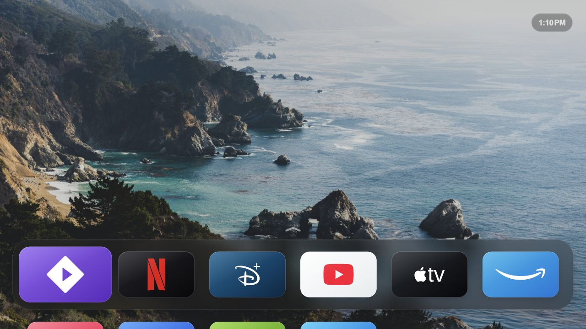
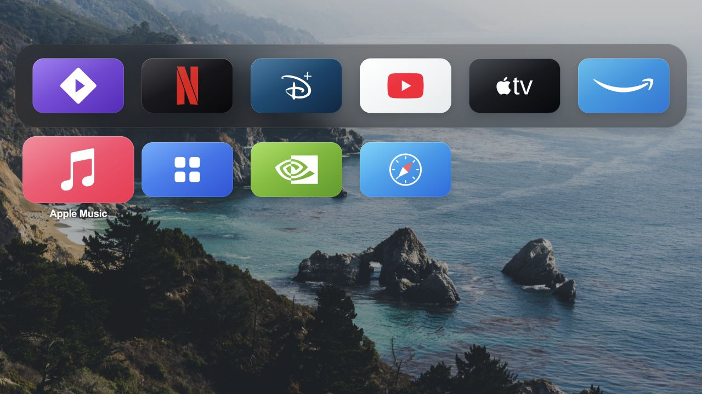
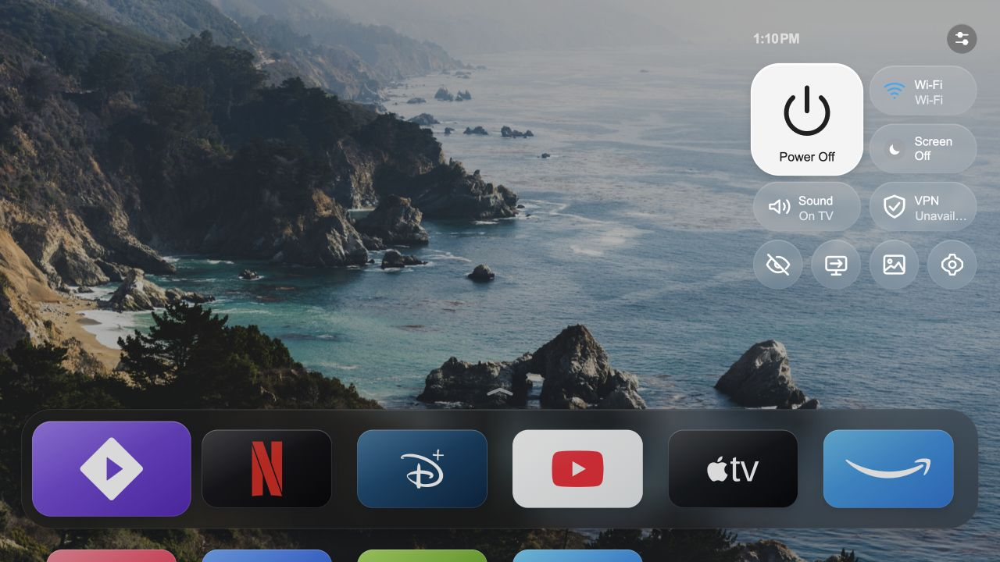

<div align="center">

# apple-tv-webos

**Give your LG TV a home screen you'll want to use.**

An Apple TV–inspired launcher with a glass favourites shelf, your own wallpaper,<br>
an app grid that opens with a tap, and a Control Centre within reach of the remote.

[](LICENSE)
[](#choose-your-setup)
[](#choose-your-setup)

[Try it](#try-it-on-your-computer) · [Install](#get-started-on-your-tv) · [Features](#make-yourself-at-home) · [Setup & recovery](docs/SETUP.md)



<sub>Browser preview of the shareable build with demo apps.</sub>

</div>

## Make yourself at home

- **Your favourites, front and centre.** A glass shelf puts the apps you reach for most one click away. Press Down to open the full app grid.
- **A layout that belongs to you.** Hold OK to move or hide an app. Restore hidden apps from Control Centre, and keep your preferred order between visits.
- **Made for the remote.** Use arrows, OK and Back, or the Magic Remote pointer. Back steps through menus before closing them.
- **Set the scene.** Choose your wallpaper, adjust its dimming, pick a 12- or 24-hour clock and add weather for your city. English and Vietnamese are available in the app.
- **Useful controls close by.** Open Control Centre from the clock for inputs, network status, wallpaper and TV settings. Root-backed services add audio and screen controls; Wi-Fi joining needs additional permissions.
- **Bring Home back to the Home button.** On a rooted TV, optional integration routes Home to the launcher, starts it after boot and refreshes the installed-app inventory.
- **Change the wallpaper from your phone.** Rooted setup adds a local phone page with a QR code, photo cropping and weather settings.
- **Take Control Centre beyond Home.** An optional rooted-TV package opens a floating panel over the current app through the Settings button.

<table>
  <tr>
    <td align="center" width="50%">
      <br>
      <strong>Favourites up front. The rest a press away.</strong>
    </td>
    <td align="center" width="50%">
      <br>
      <strong>Inputs, settings and the little things you need.</strong>
    </td>
  </tr>
</table>

*Available controls depend on the TV's services and permissions.*

## Choose your setup

You can start with Developer Mode. Root adds deeper integration with the TV.

| This project's features | Normal LG TV | Developer Mode | Rooted TV + Homebrew |
| --- | --- | --- | --- |
| Home screen | LG's original Home | This launcher opens as an installed app | Launcher app, with optional Home integration |
| Streaming apps | Open existing apps from LG Home | Open the same installed apps from this launcher | Open the same installed apps; verify playback on your firmware |
| Glass shelf, app grid, Move/Hide | Not installed | ✓ | ✓ |
| Custom wallpaper, clock and weather in this launcher | Not installed | ✓ Configure before packaging | ✓ Configure locally or through the phone page |
| Installed-app inventory | LG manages its own Home | Sync from a computer and reinstall after app changes | TV-side sync at boot and on app changes with integration enabled |
| In-app Control Centre | LG's own controls | Launcher panel and available settings shortcuts | Panel plus root-backed controls; services/permissions still apply |
| Remote Home button opens this launcher | No | No native remap¹ | Optional, with LG Input Hook |
| Launcher starts after TV boot | No | No TV-side startup integration | Optional Homebrew startup hook |
| Phone wallpaper/QR page | No | No | Optional local service |
| Floating Settings-button Control Centre | No | No supported integration | Optional package and key binding² |
| Developer Mode session renewal | Not needed | Extend the session before it expires | No Developer Mode timer |
| Setup needed | None to keep using LG Home | Computer, Developer Mode pairing and a valid session | Already-rooted TV, Homebrew and local package installation |

¹ `home-watch.py` can watch for LG Home from an always-running computer and reopen the launcher. This is a computer-side workaround; it does not remap Home or install a TV boot hook.

² The global overlay needs its own setup and verification. Wi-Fi joining requires additional scoped permissions; optional VPN controls require a separately configured helper. [Details](docs/SETTINGS-OVERLAY.md) · [VPN setup](docs/VPN-PRESETS.md)

Native **system Home replacement** is a separate advanced integration with exact firmware checks. It is not required to use the launcher and is not enabled by the ordinary setup.

## Try it on your computer

You need Git, Node.js 22 and Python 3. Clone the repository and launch the preview:

```sh
git clone https://github.com/DodgMisAHH/apple-tv-webos.git
cd apple-tv-webos
node scripts/prepare-app.cjs
python3 scripts/preview.py
```

Open **[localhost:4795](http://127.0.0.1:4795)**. Use arrows, Enter, Escape or the pointer. Hold Enter on an app to try Move/Hide; select the clock to open Control Centre.

The seed command creates local runtime files from generic examples without overwriting existing files. The preview reloads when assets change, serves only the app directory on your computer and does not control a TV.

## Get started on your TV

### Normal LG TV

Try the browser preview first. To install this custom launcher, choose Developer Mode below or use an already-rooted TV. A normal TV continues to use LG's original Home; simply cloning this repository changes nothing on the TV.

### Developer Mode — start here without root

1. Follow LG's [Developer Mode setup](https://webostv.developer.lge.com/develop/getting-started/developer-mode-app): install the app, sign in with an LG account, enable **Dev Mode Status** and let the TV restart. Reopen it and enable **Key Server**.
2. Put the TV and your computer on the same trusted network. Install Node.js 22 and Python 3 on the computer, then clone this repository as shown above.
3. From the repository directory, run:

   ```sh
   ./install-noroot.sh
   ```

4. Follow the address/pairing prompts and accept the prompt on the TV. The helper reads your app inventory, packages the launcher and installs it.
5. Use **Extend** before the Developer Mode session expires; expiration can disable Developer Mode and remove developer-installed apps. Re-run the helper when you add or remove TV apps, and use the TV's supported number-key shortcut feature for quick access.

Before packaging, edit `app/config.js` for default wallpaper, weather, language, clock and layout. Existing saved TV preferences can override those defaults. [Full Developer Mode instructions](docs/SETUP.md#developer-mode)

### Rooted TV — add Home, startup and phone controls

This path assumes **persistent root is already working** and Homebrew is installed. This project does not root the TV; the [webOS Homebrew rooting guide](https://www.webosbrew.org/rooting/) explains that separate process. Check your model and firmware with [Can I Root My TV?](https://cani.rootmy.tv/) before choosing a rooting method.

1. Build and install **this checkout's Home package** using the [rooted installation instructions](docs/SETUP.md#rooted-tv-install-the-local-package).
2. Open it and verify navigation and app launching. Install and open LG Input Hook if you want Home-button routing.
3. Stage the `tv/` helpers and follow the separate **prepare → home → startup** steps in [Home integration](docs/SETUP.md#rooted-tv-home-button-startup-and-wallpaper).
4. Check Home from another app, playback, standby/wake and a full reboot. Add the [floating Control Centre](docs/SETUP.md#optional-floating-control-centre) only when the base setup works.

Each integration has its own restore command in [Setup and recovery](docs/SETUP.md). The original upstream installer downloads a different design; build this repository to get the interface shown here.

## Build and check

Desktop development uses Node.js 22 and Python 3. Install LG's webOS CLI for `ares-package`, then run:

```sh
npm ci --ignore-scripts
node scripts/prepare-app.cjs
npm test
mkdir -p build/home
ares-package app -o build/home
```

Build the separate Control Centre package with:

```sh
node scripts/build-control-centre.cjs
ares-package build/control-centre/app -o build/control-centre
```

Checks run locally without contacting a TV. Acorn checks ES5 syntax as a development dependency; the shipped UI and TV helpers use no npm runtime dependencies. The app ID remains `com.gathin.tvhome` to preserve continuity with existing installations. [Contributing](CONTRIBUTING.md) covers the workflow and runtime constraints.

## Compatibility and project notes

This is an LG **webOS** project. There is not yet a complete model/firmware compatibility matrix. Browser checks and the screenshots above do not establish physical remote, playback, standby or reboot behavior. Historical [development notes](docs/LOCAL-LAUNCHER.md) record specific versions and one development setup.

The shareable build uses system fonts and original control icons. [Shareable-edition notes](docs/PUBLIC-SHARING.md) explain what differs from the private development build and what to review before a release. Keep pairing keys, personal inventory, wallpapers and recovery files out of Git; see [Security](SECURITY.md).

The normal floating Control Centre uses static translucent surfaces. The native-blur and compositor-zoom directories retain experiments and are outside the normal installation path; they do not establish support for blurring video playback.

## Credits and license

Built on [LG TV Vibehack](https://github.com/hoangvya19/lg-tv-webos-vibehack), with launcher lineage from [Gathin23/tv-vibehack](https://github.com/Gathin23/tv-vibehack) and appearance inspiration from [CleanFrame](https://github.com/nthnclrk/CleanFrame).

The [MIT license](LICENSE) retains the upstream copyright notices for Gathin, OmkarK97 and hoangvya19. Wallpaper, brand marks and other assets have their own provenance and terms in [Asset credits](docs/ASSET-CREDITS.md).

Thanks to the [webOS Homebrew Project](https://www.webosbrew.org), [LG Input Hook](https://github.com/Simon34545/lginputhook) and [Open-Meteo](https://open-meteo.com).

This independent project is not affiliated with Apple or LG. It is not the Apple TV operating system or streaming service. App names and trademarks identify their respective apps and do not imply endorsement.
